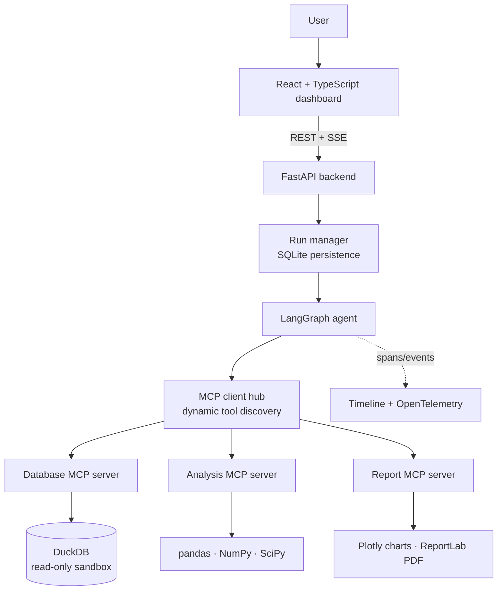
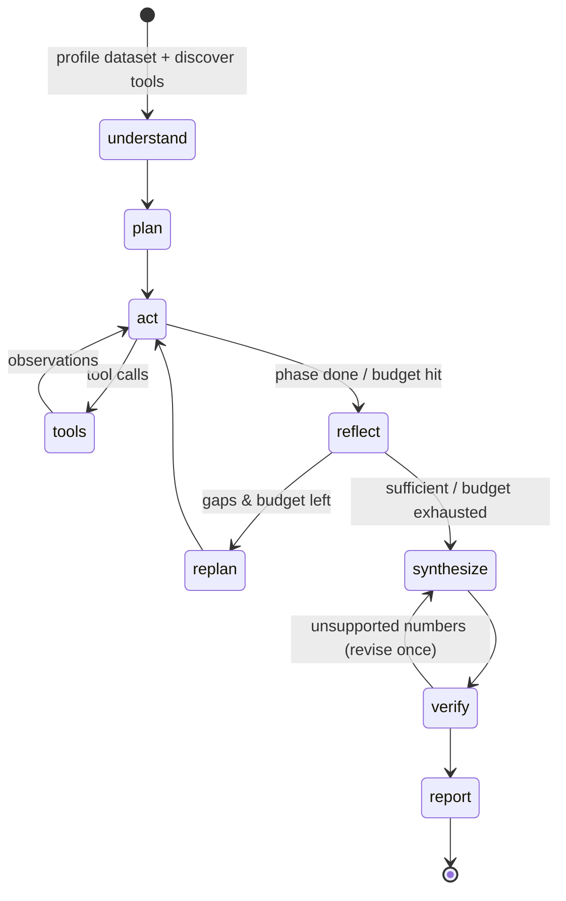

# DataBeacon

**An autonomous, MCP-powered data analyst.** Upload a dataset, ask a question in plain English
("*Why did revenue decline last quarter, and which customer segments contributed most?*"), and
DataBeacon plans an investigation, discovers its tools over the Model Context Protocol, runs SQL and
statistical tests, re-plans when the evidence is incomplete, checks every number it reports against
the actual tool outputs, and hands you a PDF report.

Every decision, LLM call, tool call and SQL query is visible in a live **Agent Execution Timeline**.


---

## Contents

- [What it does](#what-it-does)
- [Architecture](#architecture)
- [Quick start](#quick-start)
- [Getting a free Cloudflare Workers AI key](#getting-a-free-cloudflare-workers-ai-key)
- [How the agent works](#how-the-agent-works)
- [MCP servers](#mcp-servers)
- [Evidence verification](#evidence-verification)
- [Security model](#security-model)
- [Evaluation framework](#evaluation-framework)
- [Observability](#observability)
- [REST API](#rest-api)
- [Configuration](#configuration)
- [Project layout](#project-layout)
- [Development](#development)

---

## What it does

| Capability | How |
|---|---|
| **Dataset understanding** | Automatic profiling: semantic column roles (numeric / categorical / temporal / identifier), missing values, distinct counts, quartiles, IQR outliers, strong correlations, data-quality warnings |
| **Autonomous planning** | The LLM turns the question into falsifiable hypotheses, concrete date ranges and ordered steps (structured output) |
| **MCP tool discovery** | At the start of each run the agent connects to three MCP servers and lists their tools, resources and prompts. Nothing in the loop is hard-coded to a tool |
| **Tool execution** | ReAct-style tool calling over read-only SQL, hypothesis tests, anomaly detection, trend analysis and change attribution |
| **Dynamic replanning** | After each phase a reflection step judges whether the evidence answers the question. If not, it lists the gaps and the agent goes back to work |
| **Evidence verification** | Every number in every finding is checked against real tool outputs. Unsupported claims trigger an automatic revision |
| **Visualisation** | Interactive Plotly charts built from SQL queries, so each chart is evidence too |
| **Reporting** | A PDF (ReportLab) with summary, verified findings, charts, limitations, an evidence appendix with SQL, and the execution timeline |
| **Observability** | Live timeline over Server-Sent Events, OpenTelemetry spans, token and latency accounting |
| **Evaluation** | A benchmark suite that scores task success, SQL accuracy against gold queries, tool-selection F1, numerical accuracy, hallucination rate, latency and tokens |

It costs $0 to run: open-source stack, DuckDB/SQLite storage, and a free-tier LLM (Cloudflare Workers AI by default; Groq or a local model also work).

## Architecture



The agent graph:



## Quick start

### Docker (single container, UI + API)

```bash
cp .env.example .env
```

Put your Cloudflare token and account ID into `.env` (see the next section), then:

```bash
docker compose up --build
```

Open http://localhost:8000, click **Load sample e-commerce data**, pick an example question and hit **Run analysis**.

### Local development

Backend (Python 3.11+):

```bash
cd backend
pip install -r requirements-dev.txt
export CLOUDFLARE_API_TOKEN=... CLOUDFLARE_ACCOUNT_ID=...
uvicorn databeacon.api.main:app --reload --port 8000
```

Frontend (Node 20+), in another terminal:

```bash
cd frontend
npm install
npm run dev
```

The dev UI runs on http://localhost:5173 and proxies `/api` to the backend.

**No API key yet?** Start the backend with `DATABEACON_LLM_PROVIDER=scripted` to try the whole UI
with a deterministic offline policy written for the bundled sample dataset.

## Getting a free Cloudflare Workers AI key

1. Sign in at [dash.cloudflare.com](https://dash.cloudflare.com) (a free account is fine).
2. Open **My Profile → API Tokens → Create Token**.
3. Pick the **Workers AI** template and click **Use template**.
4. Under **Account Resources**, select your account, then **Continue to summary → Create Token**.
5. Copy the token straight away; Cloudflare shows it only once. This is `CLOUDFLARE_API_TOKEN`.
6. Your **Account ID** is in the right-hand sidebar of the account overview page, or in the dashboard
   URL (`dash.cloudflare.com/<ACCOUNT_ID>/...`). This is `CLOUDFLARE_ACCOUNT_ID`.

DataBeacon calls Workers AI through its OpenAI-compatible endpoint
(`/client/v4/accounts/<id>/ai/v1/chat/completions`) and uses **`@cf/openai/gpt-oss-120b`** by default,
which supports native tool calling. Override it with `DATABEACON_MODEL`.

### Staying inside the free tier

Workers AI's free allocation is **10,000 neurons per day**, reset at 00:00 UTC. DataBeacon keeps a
per-day ledger (`<data dir>/llm_usage.sqlite`) of the neurons Cloudflare reports with every response,
and stops calling Cloudflare once `DATABEACON_CLOUDFLARE_DAILY_NEURONS` (default 9,000) is reached.
After that it either uses the fallback provider or fails the run with a clear "budget reached" message,
so it can never run into paid usage on its own. `GET /api/usage` shows today's spend.

For `gpt-oss-120b`, 1M input tokens cost 31,818 neurons and 1M output tokens cost 68,182 neurons.
Measured: one analysis used **1,500–3,000 neurons** (40–80k tokens) with the default budgets, so plan on
roughly 3–5 analyses per day on the free tier. Lower `DATABEACON_MAX_TOOL_CALLS` or set
`DATABEACON_REASONING_EFFORT=low` to fit more.

Workers AI defaults to **256 output tokens** per response. That is too few for a reasoning model:
the hidden reasoning can use all of it and leave an empty answer. DataBeacon sets
`DATABEACON_MAX_OUTPUT_TOKENS` (default 4096) on every request.

### Fallback and other providers

| Provider | Variables |
|---|---|
| Cloudflare Workers AI (primary) | `CLOUDFLARE_ACCOUNT_ID` + `CLOUDFLARE_API_TOKEN` |
| Groq (fallback or primary) | `DATABEACON_FALLBACK_PROVIDER=groq` + `GROQ_API_KEY` (model `openai/gpt-oss-120b`, override with `DATABEACON_FALLBACK_MODEL`) |
| Any OpenAI-compatible server (Ollama, vLLM, LM Studio…) | `DATABEACON_LLM_PROVIDER=openai`, `DATABEACON_LLM_BASE_URL`, `DATABEACON_MODEL` |
| Offline demo | `DATABEACON_LLM_PROVIDER=scripted` |

With a fallback configured, each LLM call tries Cloudflare first. It moves to the fallback when
Cloudflare errors or the neuron budget is spent. The timeline records which provider served each call.

If your deployment sits behind an egress proxy that injects the `Authorization` header, leave the
token variables empty and set `DATABEACON_INJECTED_AUTH=1`. DataBeacon then sends a placeholder and
never reads a token.

## How the agent works

The orchestration lives in [`backend/databeacon/agent/graph.py`](backend/databeacon/agent/graph.py) as a LangGraph `StateGraph`.

1. **understand**: calls `profile_dataset` over MCP and records the tool catalogue the hub discovered.
2. **plan**: structured output (`Plan`: objective, key metric, concrete ISO time scope, hypotheses,
   steps). Relative periods such as "last quarter" are resolved against the latest date *in the data*,
   not today's date.
3. **act ⇄ tools**: the LLM is bound to the discovered MCP tools (the `dataset_id` argument is injected
   by the client and hidden from the model). Every tool result becomes a numbered piece of evidence
   (`E1`, `E2`, …) and goes back to the model in compact form.
4. **reflect**: structured `Reflection` (sufficient? hypothesis status, gaps, next actions).
5. **replan**: if the evidence is not sufficient and budget remains, the gaps are fed back and a new
   iteration starts.
6. **synthesize**: structured `Synthesis` (summary, findings with evidence ids, limitations,
   recommendations).
7. **verify**: deterministic, no LLM involved (see below). If any number is unsupported, the agent
   revises once with the exact offending values listed.
8. **report**: the report MCP server renders the PDF. If the agent made no chart, one is generated
   from the best tabular evidence.

**Reliability guardrails**

- Stopping conditions: max iterations, max tool calls overall, max tool-calling turns per phase.
- Duplicate tool calls are blocked and pointed at the existing evidence id.
- Tool errors (bad SQL, unknown column, …) are returned to the model with the database's message, so
  it can correct itself. The evaluation tracks the recovery rate.
- Unknown tools and hallucinated arguments are rejected or stripped before they reach a server.
- Tool calls emitted as JSON text by weaker open models are recovered into real tool calls.
- Rate limits and transient provider errors are retried with backoff, honouring "try again in Xs" hints.
- Older tool outputs are compacted to keep prompts inside small free-tier context limits.
- LLM failures during a phase do not kill the run; the agent continues with the evidence it has.

## MCP servers

Three independent servers built with the official MCP Python SDK. By default they run in-process; set
`DATABEACON_MCP_TRANSPORT=stdio` to run them as subprocesses, which is exactly how any other MCP
client would use them. [`mcp.example.json`](mcp.example.json) shows how to register them with a
desktop MCP client.

| Server | Tools | Resources / prompts |
|---|---|---|
| **databeacon-database** | `list_tables`, `profile_dataset`, `run_sql`, `sample_rows`, `column_values` | `datasets://catalog`, `dataset://{id}/schema`; prompts `sql_style_guide`, `hypothesis_prompt` |
| **databeacon-analysis** | `descriptive_statistics`, `correlation_analysis`, `compare_groups` (Welch t / Mann-Whitney / ANOVA / Kruskal-Wallis + effect sizes), `chi_square_test`, `detect_anomalies` (z-score / IQR / MAD), `trend_analysis` (OLS slope, Mann-Kendall, change point), `period_comparison` (change attribution by dimension) | prompt `choose_test` |
| **databeacon-report** | `create_chart` (Plotly), `generate_pdf_report` (ReportLab) | `reports://list`; prompt `report_outline` |

Run one on its own:

```bash
cd backend && python -m databeacon.mcp_servers.analysis
```

## Evidence verification

[`agent/verifier.py`](backend/databeacon/agent/verifier.py) pulls every quantitative claim out of
each finding (currency, thousands separators, `K/M/B` suffixes, percentages, percentage points), skips
years, quarter labels, ISO dates and small counts, then looks for each value:

- **directly** in the outputs of any successful tool call, with rounding-aware tolerance, or
- **derived** (difference, ratio, % change, ×100) from the values in the evidence the finding cites.

Derived matching is limited to *cited* evidence on purpose. Across a large pool of numbers almost any
value can be "derived", so the restriction keeps the check honest.

Each finding ends up `verified`, `partially_verified`, `unverified` or `qualitative`. The run reports a
**hallucination rate**: unsupported numeric claims ÷ all numeric claims.

## Security model

- **SQL sandbox** ([`sql_guard.py`](backend/databeacon/sql_guard.py)): one statement only; DuckDB's own
  parser must classify it as a `SELECT`; table functions that touch files or the network
  (`read_csv`, `read_parquet`, `glob`, …), `getenv` and URL schemes are denied.
- **Read-only execution**: queries run on a connection opened with `read_only=True`,
  `enable_external_access=false`, a 1 GB memory cap and 2 threads.
- **Resource limits**: row cap (outer `LIMIT`), wall-clock timeout that interrupts the query, upload
  size limit, run concurrency limit, per-run tool budgets.
- **Input validation**: Pydantic models for every request, sanitised identifiers and filenames, ISO
  date validation and quoted identifiers in generated SQL, strict id formats on file-serving routes.

## Evaluation framework

[`backend/evals`](backend/evals) runs the real agent end to end on a benchmark of questions about the
synthetic e-commerce dataset. The data has a known story planted in it: Q4-2025 revenue drops, mostly
because SMB customers in the West nearly stop ordering, and Electronics discounts jump from about 8% to
22%. Ground-truth numbers come from gold SQL queries run at evaluation time.

| Metric | Definition |
|---|---|
| Task success | Run completed, all expected entities named, gold values present in evidence, hallucination ≤ 10% |
| SQL validity | Share of the agent's `run_sql` calls that executed successfully |
| SQL gold match | Every gold-query value appears in some successful tool output |
| Tool selection F1 | Precision against expected + acceptable tools, recall against expected tools |
| Numerical accuracy | Share of gold values stated in the summary or findings |
| Hallucination rate | Unsupported numeric claims ÷ numeric claims (from the verifier) |
| Trajectory | Profiled first, duplicate calls, tool errors, error recovery, replans, revisions |
| Cost | Latency, LLM calls, input/output tokens, tool calls |

```bash
cd backend
python -m evals.run                     # live, all cases, configured provider
python -m evals.run --case return_rate  # a single case
python -m evals.run --mode scripted     # deterministic offline run (used in CI)
```

Results go to `evals/results/latest.json` and `latest.md`, and show up in the **Evaluation** tab.
CI runs the scripted suite on every push. With `CLOUDFLARE_API_TOKEN` / `CLOUDFLARE_ACCOUNT_ID` set as
repository secrets, the `live-eval` job also benchmarks the real model on `main`.

## Observability

- **Timeline**: every node, LLM call (with token usage), tool call (with server, arguments, SQL,
  evidence id, duration), decision (replan, stop, revise) and guardrail event is streamed to the UI
  over SSE and stored with the run.
- **OpenTelemetry**: each step is also a span (`databeacon.run_id`, step type, status, token counts).
  Set `OTEL_EXPORTER_OTLP_ENDPOINT` (and install `opentelemetry-exporter-otlp`) to ship them to Jaeger,
  Tempo, Honeycomb and similar, or `DATABEACON_OTEL_CONSOLE=1` to print them.
- **Run metrics**: latency, LLM calls, tokens, tool calls/errors and SQL count per run.

## REST API

Interactive docs at `/docs` when the backend is running.

| Method | Path | Purpose |
|---|---|---|
| GET | `/api/health` | Version, LLM provider/model, MCP transport |
| GET / POST | `/api/datasets` | List / upload (multipart: CSV, TSV, Parquet, JSON, XLSX) |
| POST | `/api/datasets/sample` | Load the bundled e-commerce dataset |
| GET / DELETE | `/api/datasets/{id}` | Metadata / delete |
| GET | `/api/datasets/{id}/profile` | Full profile |
| POST | `/api/datasets/{id}/sql` | Read-only SQL console (same sandbox as the agent) |
| GET | `/api/mcp/catalog` | Discovered MCP tools, resources and prompts |
| POST | `/api/runs` | Start an analysis `{dataset_id, question}` → `{run_id}` |
| GET | `/api/runs?dataset_id=` | Run history |
| GET | `/api/runs/{id}` | Run status and full result |
| GET | `/api/runs/{id}/events` | Live event stream (SSE) |
| GET | `/api/runs/{id}/report.pdf` | PDF report |
| GET | `/api/evals/latest` | Latest evaluation results |

## Configuration

All settings are environment variables; see [`.env.example`](.env.example).

| Variable | Default | |
|---|---|---|
| `DATABEACON_LLM_PROVIDER` | auto-detect | `cloudflare`, `groq`, `openai`, `scripted` |
| `DATABEACON_MODEL` | per provider | Model id |
| `DATABEACON_MAX_ITERATIONS` | 3 | Plan → act → reflect cycles |
| `DATABEACON_MAX_TOOL_CALLS` | 24 | Tool calls per run |
| `DATABEACON_MAX_STEPS_PER_ITERATION` | 8 | Tool-calling turns per cycle |
| `DATABEACON_SQL_TIMEOUT_S` | 15 | Query timeout |
| `DATABEACON_SQL_MAX_ROWS` | 5000 | Row cap per query |
| `DATABEACON_MAX_UPLOAD_MB` | 200 | Upload size limit |
| `DATABEACON_MCP_TRANSPORT` | `inprocess` | or `stdio` |
| `DATABEACON_DATA_DIR` | `./data` | Datasets, runs DB, reports |

## Project layout

```
backend/
  databeacon/
    agent/            LangGraph graph, prompts, schemas, verifier, evidence digests, scripted test LLM
    mcp_servers/      database, analysis and report MCP servers
    reporting/        Plotly chart builder, ReportLab PDF builder
    api/main.py       FastAPI app (also serves the built frontend)
    mcp_client.py     MCP client hub: discovery, context injection, calls
    sql_guard.py      SQL validation + read-only execution with limits
    profiling.py      dataset profiling
    analysis.py       statistics (SciPy)
    llm.py            provider layer, structured output, retries
    observability.py  timeline recorder + OpenTelemetry
    runs.py           run lifecycle and SQLite persistence
    datasets.py       upload ingestion into per-dataset DuckDB files
  evals/              benchmark cases, metrics, runner
  sample_data/        synthetic e-commerce generator
  tests/              pytest suite
frontend/
  src/components/     Analyze, Timeline, Findings, Evidence drawer, Data profile + SQL console, MCP tools, Evaluation
.github/workflows/    CI: lint, tests, scripted eval, frontend build, Docker build, live eval
```

## Development

```bash
cd backend
ruff check databeacon evals tests sample_data
pytest -q
```

```bash
cd frontend
npm run build
```

The test suite covers the SQL sandbox (including injection and file/network escape attempts),
profiling, the statistics, the verifier, MCP discovery and calls over both in-process and stdio
transports, a full agent run (replanning, error recovery, hallucination revision, PDF contents) and
the HTTP API.

## License

MIT © Aekank Patel
